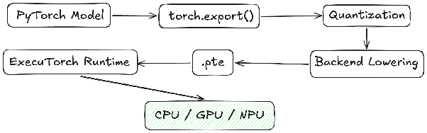

# Compute Guide: Snapdragon X Elite PC

This guide covers exporting and running ExecuTorch models on Windows 11 PCs powered by Qualcomm Snapdragon X Elite, with an emphasis on NPU delegation and measured performance.

The commands target [ExecuTorch v1.5.1](https://github.com/pytorch/executorch/releases/tag/v1.5.1) and QAIRT/QNN **2.37.0.250724**. References and command options were checked against upstream documentation and source on October 12, 2026; the Windows/NPU workflow has not been executed as part of that check.

[All tracks](../README.md) · [Accompanying artifacts](artifacts/README.md)

## Contents

- [Compute Guide: Snapdragon X Elite PC](#compute-guide-snapdragon-x-elite-pc)
  - [Contents](#contents)
  - [Core Architectural Concepts](#core-architectural-concepts)
    - [Why ExecuTorch?](#why-executorch)
    - [PyTorch to ExecuTorch Workflow](#pytorch-to-executorch-workflow)
    - [Backend Stack Hierarchy](#backend-stack-hierarchy)
  - [ExecuTorch Runtime Overview](#executorch-runtime-overview)
  - [ExecuTorch x Qualcomm AI Runtime (QAIRT)](#executorch-x-qualcomm-ai-runtime-qairt)
    - [Workflow](#workflow)
    - [Setup](#setup)
    - [Build ExecuTorch](#build-executorch)
  - [Models and Deployment Strategies](#models-and-deployment-strategies)
    - [Compiling Models](#compiling-models)
    - [Hardware Optimization](#hardware-optimization)
  - [Windows ARM64 Deployment](#windows-arm64-deployment)
    - [Stage the ARM64 Runtime](#stage-the-arm64-runtime)
    - [Package the QNN Libraries](#package-the-qnn-libraries)
    - [Load Model](#load-model)
    - [Run Inference](#run-inference)
    - [Testing](#testing)
  - [Additional Resources](#additional-resources)
  - [Device Details](#device-details)

## Core Architectural Concepts

### Why ExecuTorch?

ExecuTorch is PyTorch’s on-device inference framework, designed to bring AI models from development to deployment across PCs and other edge devices. It enables developers to take models built and trained in PyTorch, export them into an optimized runtime format, and execute them efficiently on-device with low memory overhead and minimal runtime dependencies. By supporting hardware-specific acceleration backends, ExecuTorch helps deliver responsive AI experiences while keeping inference local to the device.

For Snapdragon X Elite, ExecuTorch's Qualcomm backend lowers supported model regions to QNN HTP for Hexagon NPU execution. Operator coverage, input shapes, precision, and data movement determine the performance achieved; the profiling steps below verify the result on the laptop.

### PyTorch to ExecuTorch Workflow

ExecuTorch starts from native PyTorch models and produces hardware-specific `.pte` artifacts that are fed into the ExecuTorch Runtime for inference.



Understanding the relationship between export, lowering, and runtime execution is essential to understanding the workflow.

### Backend Stack Hierarchy

ExecuTorch supports multiple acceleration backends. See the [desktop platform documentation](https://docs.pytorch.org/executorch/1.5/platforms-desktop.html).

| Backend          | Capability       | Use case                   |
| ---------------- | ---------------- | -------------------------- |
| XNNPACK CPU      | CPU acceleration | Explicit CPU baseline      |
| Qualcomm QNN NPU | Hexagon HTP v73  | Primary NPU inference path |

For Snapdragon devices, Qualcomm QNN is the preferred backend.

## ExecuTorch Runtime Overview

The recommended runtime architecture is:

```text
Windows ARM64 Application → ExecuTorch QNN Backend → QAIRT / QNN HTP → X Elite Hexagon NPU
```

## ExecuTorch x Qualcomm AI Runtime (QAIRT)

### Workflow

Export and compile the model with x64 Python → build the Windows ARM64 runtime → run the QNN HTP delegate on the X Elite NPU. The x64 runner is a host emulator; its timings do not measure the laptop NPU. See the [Windows QNN workflow](https://docs.pytorch.org/executorch/1.5/backends-qualcomm.html).

### Setup

1. Use Windows 11 on the X Elite PC and an OEM-supported Qualcomm Hexagon NPU driver. Check the device status and driver version in Device Manager; install applicable OEM/Windows updates before testing.
2. Install Git, x64 Python 3.12, and Visual Studio 2022 with C++ desktop tools, ARM64 and x64 MSVC tools, Windows SDK, CMake, and Clang/LLVM. Use a Visual Studio Developer PowerShell. On the X Elite itself, use AMD64 Python under emulation for ahead-of-time (AOT) dependencies. If using Visual Studio 2026, the QNN build script requires CMake 4 or later on the developer shell's `PATH`. See [Windows build prerequisites](https://docs.pytorch.org/executorch/1.5/using-executorch-building-from-source.html).
3. Enable Windows Developer Mode for Git symlinks, or clone from a shell with permission to create them. Use the same ExecuTorch checkout for export and runtime, and record its commit.
4. Install QAIRT/QNN manually on Windows. Version **2.37.0.250724** matches the release's [SDK version configuration](https://github.com/pytorch/executorch/blob/v1.5.1/backends/qualcomm/scripts/qnn_config.sh); use matching compiler/runtime libraries. Recheck the configuration when changing ExecuTorch versions. Use the [QNN SDK download for this version](https://softwarecenter.qualcomm.com/api/download/software/sdks/Qualcomm_AI_Runtime_Community/All/2.37.0.250724/v2.37.0.250724.zip), or select the matching version in [Qualcomm Software Center](https://softwarecenter.qualcomm.com/catalog/item/Qualcomm_AI_Runtime_Community).

```powershell
git clone -c core.symlinks=true --branch v1.5.1 --recurse-submodules https://github.com/pytorch/executorch.git
cd executorch
$env:EXECUTORCH_ROOT = (Get-Location).Path
python -m venv .venv
.\.venv\Scripts\Activate.ps1
python -c "import sysconfig; assert sysconfig.get_platform() == 'win-amd64'"
git rev-parse HEAD
$env:QNN_SDK_ROOT = "C:\Qualcomm\AIStack\QAIRT\2.37.0.250724"
& "$env:QNN_SDK_ROOT\bin\envsetup.ps1"
$env:PYTHONPATH = "$env:EXECUTORCH_ROOT\..;$env:PYTHONPATH"
python install_executorch.py
```

Set `QNN_SDK_ROOT` to the extracted directory containing `QNN_README.txt`. Stop on any installation error. The [upstream Python installer](https://github.com/pytorch/executorch/blob/v1.5.1/install_executorch.py) installs the checkout's dependencies and example requirements.

For a fresh environment, let the installer select the release's dependency versions. `--use-pt-pinned-commit` assumes PyTorch has already been provisioned, as in upstream CI; it does not fetch a pinned PyTorch commit. See the [dependency installer](https://github.com/pytorch/executorch/blob/v1.5.1/install_requirements.py).

### Build ExecuTorch

```powershell
.\backends\qualcomm\scripts\build.ps1 -Release
```

Build both architectures: x64 supplies the AOT Python bindings; ARM64 supplies the on-device runner. The [Windows build script](https://github.com/pytorch/executorch/blob/v1.5.1/backends/qualcomm/scripts/build.ps1) also enables developer tools and event tracing. An x64 Windows workstation can cross-compile, then transfer the ARM64 bundle to the laptop.

## Models and Deployment Strategies

### Compiling Models

First compile the upstream DeepLab example with representative calibration data. Run from `EXECUTORCH_ROOT` in the x64 Python environment:

```powershell
python -m examples.qualcomm.scripts.deeplab_v3 --build_folder build-x86_64-windows --soc_model SC8380XP --backend htp --compile_only --download
```

Output: `deeplab_v3\dlv3_qnn.pte`. The [DeepLab export example](https://github.com/pytorch/executorch/blob/v1.5.1/examples/qualcomm/scripts/deeplab_v3.py) uses INT8 activations/weights for HTP and downloads calibration data/model weights. Avoid its random-input CI option for accuracy evaluation. `SC8380XP` selects X Elite's Hexagon v73 (SoC ID 60). See the [chipset mapping](https://github.com/pytorch/executorch/blob/v1.5.1/backends/qualcomm/serialization/qc_schema.py).

For your model, follow the [QNN custom-model example](https://github.com/pytorch/executorch/blob/v1.5.1/examples/qualcomm/scripts/export_example.py): export → QNN post-training quantization (PTQ) calibration on representative inputs → convert → lower with `to_edge_transform_and_lower_to_qnn()` → call `to_executorch()` and save `.pte`. Start with supported fixed input shapes and INT8; try higher precision only where measured accuracy requires it. Pass `SC8380XP` to the quantizer and compiler. A generic CPU `.pte` will not start using the NPU simply because the PC has one.

### Hardware Optimization

Inspect delegation after lowering and before `to_executorch()`. In your exporter, `edge_manager` below is the returned `EdgeProgramManager`:

```python
from executorch.devtools.backend_debug import get_delegation_info

info = get_delegation_info(edge_manager.exported_program().graph_module)
print(info.get_summary())
print(info.get_operator_delegation_dataframe())
```

Prioritize costly convolutions, matrix multiplies, and attention in QNN partitions. Use the [operator support matrix](https://github.com/pytorch/executorch/tree/v1.5.1/backends/qualcomm/builders#operator-support-status) to replace or restructure unsupported operations; remove unnecessary skip-delegation settings. Reduce CPU↔NPU boundaries, layout conversions, and repeated copies. A delegated-op count alone does not measure NPU busy time. See [delegation inspection](https://docs.pytorch.org/executorch/1.5/llm/export-custom-llm.html#visualizing-the-delegation).

Keep the model loaded and reuse input/output buffers. Preprocess the next input while the previous inference runs when the application permits it. Benchmark batching only if its latency and memory cost fit the workload. For LLMs, use the [model-specific QNN export and runner](https://github.com/pytorch/executorch/tree/v1.5.1/examples/qualcomm/oss_scripts), with `SC8380XP` targeting; measure prefill and decode separately. The single-forward DeepLab runner is not an autoregressive chat loop.

## Windows ARM64 Deployment

### Stage the ARM64 Runtime

In PowerShell on the build machine, run from `EXECUTORCH_ROOT` to create a self-contained run directory:

```powershell
$bundle = "$env:EXECUTORCH_ROOT\xelite-run"
New-Item -ItemType Directory -Force $bundle | Out-Null
$armBuild = "$env:EXECUTORCH_ROOT\build-arm64-windows"
Copy-Item "$armBuild\examples\qualcomm\executor_runner\Release\qnn_executor_runner.exe" $bundle
Copy-Item "$armBuild\backends\qualcomm\Release\qnn_executorch_backend.dll" $bundle
Copy-Item ".\deeplab_v3\dlv3_qnn.pte" $bundle
```

### Package the QNN Libraries

```powershell
$qnnArm = "$env:QNN_SDK_ROOT\lib\aarch64-windows-msvc"
Copy-Item "$qnnArm\QnnHtp.dll" $bundle
Copy-Item "$qnnArm\QnnSystem.dll" $bundle
Copy-Item "$qnnArm\QnnHtpV73Stub.dll" $bundle
Copy-Item "$env:QNN_SDK_ROOT\lib\hexagon-v73\unsigned\*" $bundle
```

Keep the v73 skeleton and its accompanying catalog files together. These Hexagon `.so` files are DSP binaries, even on Windows. All Windows DLLs must come from the ARM64 SDK directory and the same SDK version used for compilation. Copy the entire `xelite-run` directory to the X Elite PC if built elsewhere. See [Windows runtime libraries](https://docs.pytorch.org/executorch/1.5/backends-qualcomm.html#run-model-inference-on-windows-on-snapdragon-wos-with-qualcomm-socs) and [Qualcomm's Windows packaging example](https://docs.qualcomm.com/doc/80-94755-1/80-94755-1_REV_AA_QAI_AppBuilder_-_WoS.pdf).

### Load Model

On the X Elite PC, open PowerShell in `xelite-run` and execute the ARM64 runner:

```powershell
.\qnn_executor_runner.exe --model_path .\dlv3_qnn.pte
```

The runner looks for `input_list.txt` in the working directory by default. If it cannot open the input list, it runs with default inputs; that is only a loader/inference smoke test and does not establish model accuracy. For real data, serialize preprocessed tensors to raw binary files with the exported dtype, shape, and layout; `input_list.txt` contains one sample per line and one path per model input, separated by single spaces. Use paths without spaces, omit blank lines, and resolve relative paths from the runner's working directory. See [runner input handling](https://github.com/pytorch/executorch/blob/v1.5.1/examples/qualcomm/executor_runner/qnn_executor_runner.cpp).

### Run Inference

After preparing a nonempty, readable `input_list.txt`, create an outputs directory and start with a sustained-performance benchmark. Check that the logs show the expected input samples; a missing input list silently falls back to default inputs.

```powershell
New-Item -ItemType Directory -Force .\outputs
.\qnn_executor_runner.exe --model_path .\dlv3_qnn.pte --input_list_path .\input_list.txt --output_folder_path .\outputs --warm_up 10 --iteration 100 --htp_performance_mode 1 --profile_level 0
```

In this release, mode `1` is sustained high performance and mode `2` is burst. Compare burst for short requests; retain sustained mode only when it improves the real workload within power/thermal limits. Check `--help` for your build. With `--iteration 100`, use the per-input `avg` log value for latency per inference. The final `Total ... avg` and `inference_speed.txt` values average over input samples, not iterations; divide those values by `100` for mean latency per inference. Keep power mode, AC/battery state, input set, and background NPU workload constant. See [runner flags](https://github.com/pytorch/executorch/blob/v1.5.1/examples/qualcomm/executor_runner/qnn_executor_runner.cpp) and [HTP performance modes](https://github.com/pytorch/executorch/blob/v1.5.1/backends/qualcomm/serialization/qc_schema.py).

### Testing

Confirm NPU execution with a separate diagnostic run using the same inputs and output directory:

```powershell
.\qnn_executor_runner.exe --model_path .\dlv3_qnn.pte --input_list_path .\input_list.txt --output_folder_path .\outputs --warm_up 0 --iteration 1 --htp_performance_mode 1 --profile_level 2 --etdump_path .\xelite.etdp
```

Inspect QNN delegate and CPU events with ExecuTorch Inspector. The Windows build above enables tracing; retain an ETRecord from export if source-level attribution is needed. Detailed profiling adds overhead, so keep these timings separate from the benchmark. See [ExecuTorch profiling](https://docs.pytorch.org/executorch/1.5/runtime-profiling.html).

Correlate a sustained run with **Task Manager → Performance → NPU**; use WPR/WPA or Snapdragon Profiler when aggregate utilization is ambiguous. Task Manager is corroboration, not proof that every operator was delegated. See [Windows NPU measurement tools](https://learn.microsoft.com/en-us/windows/ai/npu-devices/#how-to-measure-performance-of-ai-models-running-locally-on-the-device-npu).

Compare outputs with the PyTorch reference on held-out data. Record:

- Cold-load time.
- Warmed inference latency and throughput.
- End-to-end latency, including preprocessing.
- CPU fallback time.
- Memory use.
- Sustained power and thermal behavior.

Compare against an explicit CPU baseline. Optimize useful throughput at acceptable accuracy and latency; a 100% utilization reading is not itself success.

If loading fails, check ARM64 versus x64 binaries, missing DLLs/v73 skeleton/catalog files, the OEM driver, and matching QNN compiler/runtime versions. If NPU activity is low, check delegation and CPU preprocessing before changing performance mode. Rebuild/re-export when changing the SDK or checkout.

## Additional Resources

- [ExecuTorch Documentation](https://docs.pytorch.org/executorch/stable/index.html)
- [PyTorch Export Documentation](https://docs.pytorch.org/docs/stable/user_guide/torch_compiler/export.html)
- [Qualcomm AI Hub](https://aihub.qualcomm.com/)
- [ExecuTorch GitHub Repository](https://github.com/pytorch/executorch)

## Device Details

| Property                   | Value                       |
| -------------------------- | --------------------------- |
| Type                       | Windows 11 ARM64 compute PC |
| Chipset                    | Qualcomm Snapdragon X Elite |
| ExecuTorch target          | `QcomChipset.SC8380XP`      |
| Hexagon / HTP architecture | v73                         |
| SoC ID                     | 60                          |
